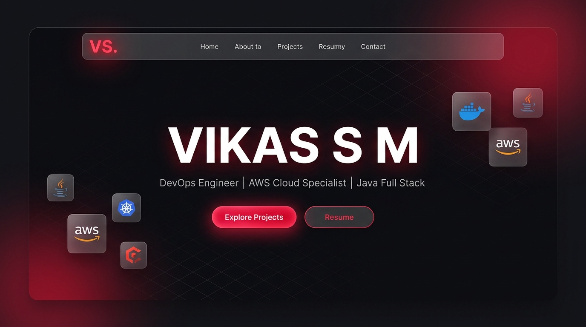
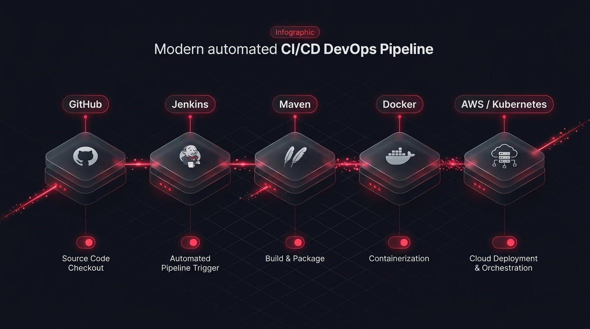
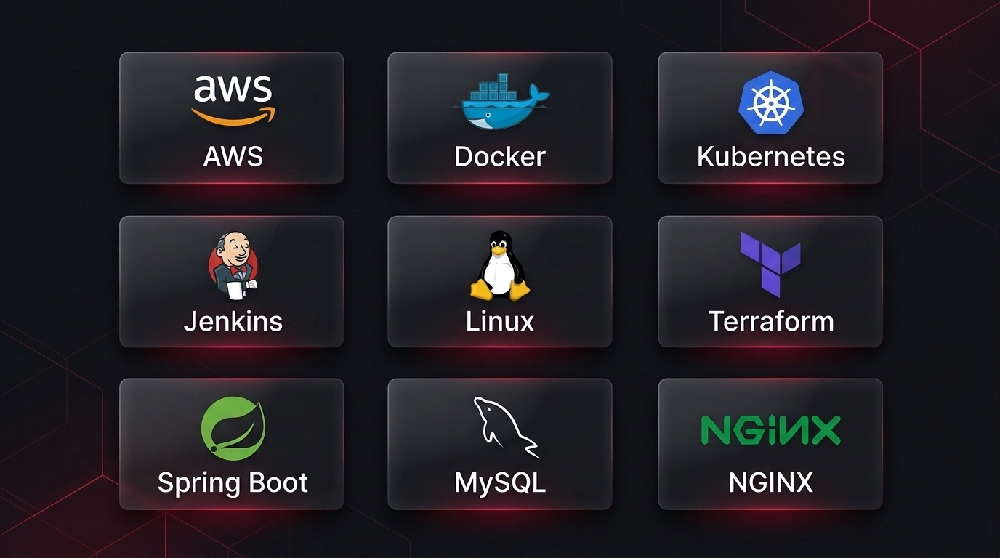

<div align="center">

# 🚀 Vikas S M — DevOps & Full-Stack Portfolio

**A high-performance, responsive personal developer portfolio engineered with React 19, Vite, and modern CSS.**

[](#)
[](#)
[](#)
[](#)

</div>

---

## 📖 About The Project

This project is a modern, responsive personal developer portfolio tailored for **DevOps Engineers, Cloud Specialists, and Full-Stack Developers**. It showcases hands-on engineering capabilities across AWS cloud architecture, container orchestration with Docker and Kubernetes, and end-to-end CI/CD automation pipelines using Jenkins.

The code has been built from the ground up to be **simple, friendly, and small**:
- **Zero bloat**: Written in pure React and lightweight CSS without heavy UI frameworks.
- **Data-driven**: All content (bio, skills, projects, links) lives in one intuitive file (`src/data/portfolioData.js`), making it effortless to customize.
- **Component-based**: Clean, bite-sized components under `src/components/`, each focusing on a single section.

---

## 🖼️ Visual Previews

### 1. Interactive Hero Section
*Kinetic cursor-responsive typography, dynamic typing roles, and fast navigation.*



---

### 2. CI/CD Pipeline Architecture Diagram
*Visual step-by-step pipeline flows with animated data-connector pulses.*



---

### 3. Cloud & DevOps Tech Stack Showcase
*Categorized technical skills with authentic brand vectors via Devicon CDN.*



---

## ✨ Key Features

- **⚡ Lightweight & Blazing Fast**: Built on Vite 8 and React 19 with production build times under 400ms.
- **🎨 Dark & Light Modes**: Seamless theme toggle with persistent styling and smooth CSS variable transitions.
- **📊 Interactive Architecture Flow**: Custom SVG diagrams showing real DevOps deployment workflows (GitHub ➔ Jenkins ➔ Maven ➔ Docker ➔ AWS/K8s).
- **✍️ Kinetic Name Typography**: Interactive letter stretching effect tracking cursor movement on pointer events.
- **📱 100% Mobile & Tablet Responsive**: Fullscreen slide-over menu for smaller screens, responsive grids, and touch-friendly targets.
- **📬 One-Click Contact Form**: Integrated email launch form that auto-fills message subjects and sender details.
- **📄 Downloadable Resume**: Direct PDF asset linking from the `public/` folder.

---

## 🏗️ How It Is Built

### Tech Stack
| Layer | Technology | Description |
|---|---|---|
| **Frontend Framework** | [React 19](https://react.dev/) | Component architecture, state hooks, and fast VDOM reconciliation. |
| **Build Tool & Bundler** | [Vite 8](https://vite.dev/) | Instant HMR dev server and optimized Rollup/ESBuild production builds. |
| **Icons & Badges** | [Devicon CDN](https://devicon.dev/) | Authentic SVG logos loaded on-demand for zero bundle overhead. |
| **Styling** | Modern CSS | CSS custom properties (variables), Flexbox, CSS Grid, and media queries. |

### Component Architecture

```
src/
├── assets/                  # Static media and icons
├── components/              # Modular, single-responsibility UI components
│   ├── About.jsx            # Bio, stats, experience, and certifications
│   ├── Contact.jsx          # Contact links and message form
│   ├── Footer.jsx           # Copyright and scroll-to-top button
│   ├── Hero.jsx             # Kinetic typography & typing role banner
│   ├── Loader.jsx           # Snappy splash screen loading percentage
│   ├── Navbar.jsx           # Navigation header & mobile slide-out menu
│   ├── Projects.jsx         # Project showcase & CI/CD pipeline flowcharts
│   └── Skills.jsx           # Categorized tech badges and logos
├── data/
│   └── portfolioData.js     # Single source of truth for all content
├── App.css                  # Clean, unified style system
├── App.jsx                  # Main root application orchestrator (~70 lines)
├── index.css                # Global resets and root styling
└── main.jsx                 # React root mount entry point
```

---

## 🚀 Getting Started

Follow these steps to run the portfolio locally on your machine.

### Prerequisites
- [Node.js](https://nodejs.org/) (version 18.0 or newer)
- npm or yarn

### 1. Clone the repository
```bash
git clone https://github.com/Vikas6360/FUTURE_FS_01.git
cd FUTURE_FS_01
```

### 2. Install dependencies
```bash
npm install
```

### 3. Start the development server
```bash
npm run dev
```
Open your browser and navigate to `http://localhost:5173`.

### 4. Build for production
```bash
npm run build
```
The optimized production bundle will be generated in the `dist/` directory.

### 5. Preview production build locally
```bash
npm run preview
```

### 6. Run linting checks
```bash
npm run lint
```

---

## 🛠️ Customizing for Your Own Profile

All project data is decoupled from the UI logic. To personalize the portfolio with your own information, edit **`src/data/portfolioData.js`**:

```javascript
// Example: src/data/portfolioData.js
export const personalInfo = {
  name: 'YOUR NAME',
  roles: ['DevOps Engineer', 'Cloud Architect'],
  heroDescription: 'Your personalized bio statement...',
  contactDetails: {
    email: 'you@example.com',
    linkedin: 'https://linkedin.com/in/your-handle',
    github: 'https://github.com/your-username'
  }
}
```

---

## 📦 Deployment

You can deploy this site in seconds to any static hosting provider:

- **Vercel**: Import the GitHub repo and click **Deploy** (framework preset: `Vite`).
- **Netlify**: Connect your repository with build command `npm run build` and publish directory `dist`.
- **GitHub Pages**: Build the project and deploy the `dist/` folder via GitHub Actions.
- **AWS S3 + CloudFront**: Sync `dist/` into an S3 bucket configured for static web hosting behind CloudFront CDN.

---

## 📄 License

This project is open-source and available under the [MIT License](LICENSE).
